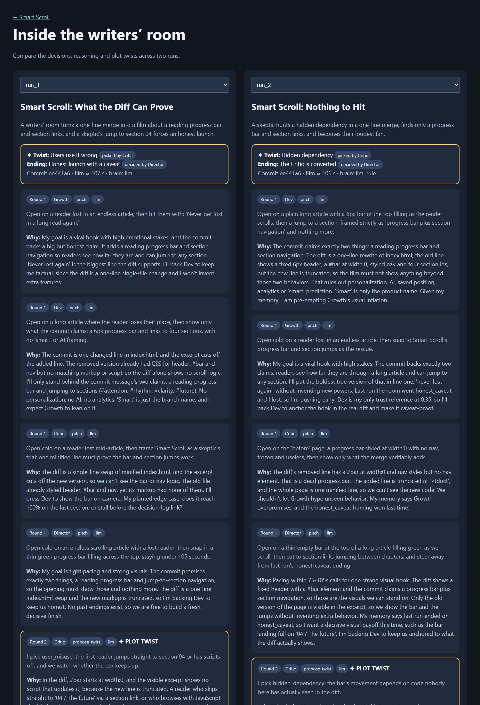

# MergeCut: the launch film that writes itself

**Every merge to `main` becomes a 75-105 second animated launch film, written by four AI agents who argue about it.**

Multiplayer AI Hackathon, Track 1 (Agent Animated Film). No human in the loop at runtime.

**See it:** [angioz.github.io/hackathon](https://angioz.github.io/hackathon/): the [writers' room replay](https://angioz.github.io/hackathon/live/) of a real run, and [run 1 vs run 2](https://angioz.github.io/hackathon/decision-log/).

```
git merge -> Bruin pipeline (4 agents, 4 rounds, memory, decision log, quality checks)
          -> story_bible.json + decision_log.json + rewritten_script.json
          -> launch film written, voiced and rendered by our video pipeline, the 4 agents as characters
          -> auto-publisher receipt
```

## The cast

| Agent | Role | Wants | Secret goal |
|---|---|---|---|
| **Dev** | Pragmatic Staff Engineer | Technical accuracy, zero hype | Never claim what the code doesn't do |
| **Growth** | Hype Marketing Director | A viral hook, big stakes | Biggest possible claim in the first line |
| **Critic** | Skeptical user and chaos QA | Break it, inject the plot twist | Prove an edge case on camera |
| **Director** | Showrunner and arbiter | Pacing, visuals, a decisive ending | Never repeat last run's ending |

## How a film gets decided

1. **Pitch:** each agent proposes how to frame the merged feature and backs or attacks a rival.
2. **Twist:** the Critic picks the mid-film plot twist (twists used in recent runs are banned by memory); the others support or oppose it.
3. **Vote:** all four vote on the ending (last run's ending is banned).
4. **Arbitration:** the Director decides, weighting each vote by how much she trusts that agent (trust is stored in memory and changes every run).

Every decision is written to the `decision_log` table with **what** was decided and **why**. After the run each agent writes a reflection and updated alliance weights to `agent_memory`, which it reads at the start of the next run.

## Hackathon rules: where to check each one

| Requirement | How we meet it | Evidence |
|---|---|---|
| Bruin (mandatory sponsor) | 5-asset Bruin pipeline (4 Python + 1 SQL) on DuckDB; `bruin validate` and `bruin run` pass (5/5 assets, 13/13 quality checks). Synced to Bruin Cloud (5 assets, no validation errors). The 4 characters also exist as Bruin Cloud agents (backup brain). | [`bruin-pipeline/`](bruin-pipeline/), [Cloud sync proof](docs/evidence/bruin-cloud.txt), [Bruin Cloud lineage](docs/evidence/bruin-lineage.png) |
| At least 3 agents with distinct roles, goals, personalities | 4 agents with opposing goals and secret goals | [`bruin-pipeline/lib/cast.py`](bruin-pipeline/lib/cast.py), DuckDB `agents` |
| Agents decide story, twist and ending | 4-round writers' room; every turn is a live LLM call (DeepSeek v4.1 Flash via Runware; runs 1 and 2 used Claude Opus 5.5), recorded per decision as `llm_mode`. Watch it live on the demo screen | [`room.py`](bruin-pipeline/lib/room.py), [run 1 decision log](docs/evidence/run_1/decision_log.json), [live screen](docs/evidence/live-screen-final.png) |
| Decision log: what and why | `decision_log` table + `decision_log.json`, with Bruin checks for non-empty `reasoning_why`, a plot twist, and at least 3 agents | [`assets/story_quality_checks.sql`](bruin-pipeline/assets/story_quality_checks.sql), [sample](bruin-pipeline/contracts/sample/decision_log.json) |
| Different runs, different outcomes | Memory bans recent twists and the last ending; trust weights shift the vote. Same commit, two runs: different twist **and** ending (tested) | [Run comparison](#run-comparison), [side-by-side viewer screenshot](docs/evidence/decision-log-run1-vs-run2.png), `tests/test_outputs.py::test_run1_and_run2_differ` |
| Agent memory and adaptive behaviour (bonus) | `agent_memory` rows per run: reflection, alliance weights, twist and ending history. Visible in run 2: the Director cites her trust in Dev (0.75) and avoids run 1's ending | [run 2 decision log](docs/evidence/run_2/decision_log.json) |
| Visual characters with movement and interaction | Every scripted line carries a stage move, a look-at target, a prop interaction and a pose | [sample story bible](bruin-pipeline/contracts/sample/story_bible.json); renderer: *pending (Lane A)* |
| 1-3 minute film | Script is checked for 60-180 s by a Bruin quality check and a test Real voiced audio: run 1 **91.1 s**, run 2 **99.4 s** | [run 1 audio](docs/evidence/run_1/full_script_audio.wav), [run 2 audio](docs/evidence/run_2/full_script_audio.wav); *final MP4 pending (Lane A)* |
| Voice (bonus) | 4 distinct ElevenLabs voices: Dev = Adam, Growth = Antoni (male); Critic = Jessica, Director = Sarah (female). Every word timed (243/243 and 238/238) | [run 1 audio](docs/evidence/run_1/full_script_audio.wav), [word timings](docs/evidence/run_1/voice_words.json), [`voice/`](voice/) |
| Zero human in the loop | A `git merge` in the demo repo fires a post-merge hook that runs the whole pipeline with zero prompts (79 s); also one CLI command or a signed GitHub webhook | [`launch/`](launch/), [`scripts/create_demo_repo.py`](scripts/create_demo_repo.py), [`scripts/install_post_merge.py`](scripts/install_post_merge.py) |
| Demo video with AdaL | | *pending* |

## Run it

Requirements: Python 3.11+, Node, [Bruin CLI](https://getbruin.com/docs/bruin/getting-started/introduction/installation.html), `pip install duckdb==1.5.2 pytest`.

```bash
# .env.local (git-ignored). Without these, a template stand-in brain is used (llm_mode "offline").
#   LLM_BASE_URL=https://api.runware.ai/v1   LLM_API_KEY=...   LLM_MODEL=deepseek-v4-1-flash
#   BRUIN_CLOUD_API_KEY=...   (backup brain: py launch/setup_bruin_agents.py)
#   ELEVENLABS_API_KEY=...    (voices: py voice/synthesize_voices.py)

bruin validate bruin-pipeline

# One command, zero prompts: commit -> Bruin -> (render) -> publish receipt
py launch/run_autonomous_launch.py --commit HEAD --fresh --label run_1
py launch/run_autonomous_launch.py --commit HEAD --label run_2

# The demo: a real merge fires the pipeline
py scripts/create_demo_repo.py --reset && py scripts/install_post_merge.py
git -C demo-app/.demo-repo merge --no-ff feat/smart-scroll -m "Merge feat/smart-scroll"
cd demo-app && npm run dev        # localhost:3000/live (watch the room live), /decision-log (run 1 vs run 2)
#   offline fallback: localhost:3000/live?replay=golden

# Tests (contract, why, agents, twist, length, divergence)
py -m pytest tests -q

# Or listen for merges (GitHub webhook, HMAC-verified)
GITHUB_WEBHOOK_SECRET=... py launch/webhook_server.py --port 8787
```

Outputs land in `output/<run_id>/` (also mirrored to `output/latest/`): `feature_payload.json`, `story_bible.json`, `decision_log.json`, `rewritten_script.json`, `publish_receipt.json`, `run_manifest.json`.

The publisher defaults to **dry run** and only posts to an allow-listed channel when explicitly switched to live.

## Run comparison

Same merge commit (`ee441a6`, the Smart Scroll merge in the demo repo), every decision made by Claude Opus 5.5 (the live demo now runs DeepSeek v4.1 Flash, about 60 s per run):

| | Run 1 (fired by `git merge`) | Run 2 (CLI, same commit) |
|---|---|---|
| Title | *Smart Scroll: What the Diff Can Prove* | *Smart Scroll: Nothing to Hit* |
| Plot twist (Critic) | Users use it wrong: a reader jumps straight to section 04 | Hidden dependency: "something moves that bar" |
| Ending (Director) | Honest launch with a caveat (weighted vote 4.50 vs 1.50) | The Critic is converted (3.25 vs 1.75); run 1's ending banned by memory |
| Voiced audio | 91.1 s ([listen](docs/evidence/run_1/full_script_audio.wav)) | 99.4 s ([listen](docs/evidence/run_2/full_script_audio.wav)) |
| Evidence | [`docs/evidence/run_1/`](docs/evidence/run_1/) | [`docs/evidence/run_2/`](docs/evidence/run_2/) |


